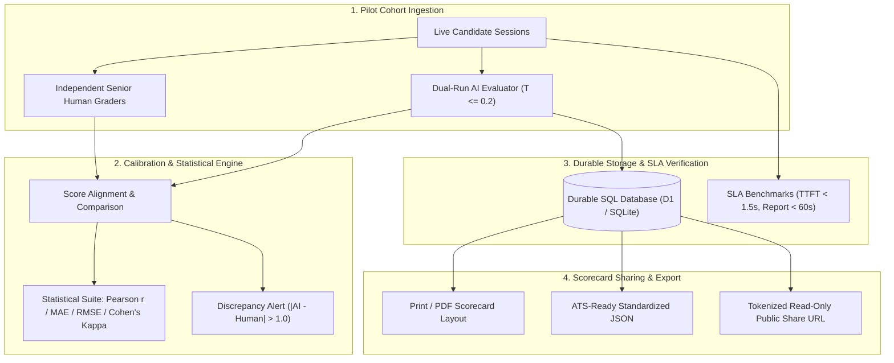

# Week 6 Implementation Plan: Pilot Milestone & Production Hardening

> **Goal:** Complete the pilot capstone milestone of the TestMeMan AI Technical Interviewer: run real student cohort trials, compare automated AI evaluations against independent human interviewer scores with statistical correlation (Pearson $r$, MAE, RMSE, Weighted Cohen's Kappa), enforce strict SLA verification ($< 1.5$s TTFT, $< 60$s report generation), implement durable SQL database persistence, and deliver standardized ATS & PDF report exports with exhaustive edge-case resilience.

---

## Progress Overview

- [ ] **Phase 1: Pilot Evaluation & Human-AI Correlation Engine (`packages/core/src/pilot.ts`)**
- [ ] **Phase 2: SLA Benchmark Suite & Latency Verification (`packages/core/test/benchmark/sla.test.ts`)**
- [ ] **Phase 3: Durable SQL Database Persistence & Migration Tooling (`apps/api/src/db/`)**
- [ ] **Phase 4: Standardized Scorecard Export & Shareable Links (`packages/ui` & `apps/api`)**
- [ ] **Phase 5: Golden Verification, CI Integration & Production Hardening**

---

## Architecture & Data Flow

---

## Detailed Checklists

### Phase 1: Pilot Evaluation & Human-AI Correlation Engine (`packages/core/src/pilot.ts`)
- [ ] **1.1 Benchmark Data Contracts (`packages/contracts/src/pilot.ts`)**
  - [ ] Define `HumanEvaluationBenchmarkSchema`:
    - `candidateId`, `interviewId`, `problemId`.
    - Dimension ratings (1–4) for: `problemSolving`, `codeCorrectness`, `testingEdgeCases`, `complexityReasoning`, `communication`.
    - `graderId`, `graderExperienceYears`, `verbatimNotes`.
  - [ ] Define `CorrelationReportSchema`:
    - Per-dimension metrics: Pearson $r$, Mean Absolute Error (MAE), Root Mean Square Error (RMSE), Quadratic Weighted Cohen's Kappa ($\kappa$).
    - Overall cohort inter-rater agreement index.
    - List of flagged outlier sessions ($|Score_{AI} - Score_{Human}| > 1.0$).
- [ ] **1.2 Statistical Computation Module (`packages/core/src/pilot.ts`)**
  - [ ] Implement `calculatePearsonR(x: number[], y: number[]): number`:
    - Computes sample Pearson correlation coefficient with division-by-zero safeguards for constant inputs.
  - [ ] Implement `calculateMAE(actual: number[], predicted: number[]): number` and `calculateRMSE(...)`.
  - [ ] Implement `calculateQuadraticWeightedKappa(humanScores: number[], aiScores: number[]): number`:
    - Construct $4 \times 4$ observed matrix $O$ and expected matrix $E$.
    - Quadratic weights $w_{ij} = \frac{(i - j)^2}{(k - 1)^2}$.
    - Standardized agreement score with chance correction.
- [ ] **1.3 Cohort Analysis Runner & Automated Calibration (`packages/core/src/calibration.ts`)**
  - [ ] Load cohort benchmark pairs from `data/pilot/`.
  - [ ] Generate comprehensive Markdown and JSON calibration reports (`reports/pilot-calibration-report.md`).
  - [ ] Target validation thresholds:
    - Pearson $r \ge 0.85$ across all dimensions.
    - $\text{MAE} \le 0.40$ on the 1–4 scale.
    - Cohen's $\kappa \ge 0.75$ (substantial agreement).

---

### Phase 2: SLA Benchmark Suite & Latency Verification (`packages/core/test/benchmark/sla.test.ts`)
- [ ] **2.1 Time-to-First-Token (TTFT) Benchmark Suite**
  - [ ] Measure streaming response latency across representative candidate prompts:
    - Greeting / Introduction turn.
    - Syntax clarification query.
    - Live coding execution feedback turn.
    - Algorithmic complexity follow-up.
  - [ ] Assert SLA contract: TTFT $p_{50} < 800\text{ ms}$, $p_{95} < 1400\text{ ms}$ (strict upper bound $< 1.5\text{ s}$).
- [ ] **2.2 End-to-End Evaluation Turnaround Benchmark**
  - [ ] Measure full evaluation handshake:
    - PII redaction and transcript sanitization.
    - Code snapshot timeline scrubber.
    - Independent Run 1 evaluation ($T \le 0.2$).
    - Independent Run 2 evaluation ($T \le 0.2$).
    - Consistency verification bound check ($|Run1 - Run2| \le 1$).
    - Final consensus scorecard synthesis and serialization.
  - [ ] Assert SLA contract: complete turnaround time $< 45\text{ s}$ (strict project SLA $< 60\text{ s}$).
- [ ] **2.3 NPM Benchmark Script**
  - [ ] Register `pnpm test:sla` in root `package.json` and `packages/core/package.json`.

---

### Phase 3: Durable SQL Database Persistence & Migration Tooling (`apps/api/src/db/`)
- [ ] **3.1 Relational Database Schema (`apps/api/src/db/schema.sql`)**
  - [ ] `interviews`: UUID primary key, candidate identifier, problem ID, programming language, active phase, created/updated timestamps.
  - [ ] `dialogue_turns`: Auto-incrementing turn index, interview UUID foreign key, role (`interviewer` / `candidate` / `system`), content, phase timestamp.
  - [ ] `code_revisions`: Snapshot UUID, interview foreign key, code content, trigger reason (`keystroke`, `test_run`, `phase_transition`), timestamp.
  - [ ] `test_executions`: Run UUID, interview foreign key, stdout, stderr, exit code, passed boolean, duration ms, timestamp.
  - [ ] `evaluations`: Evaluation UUID, interview foreign key, overall score, recommendation, dimensions JSON, strengths JSON, gaps JSON, consensus status, timestamp.
  - [ ] `token_usage_ledger`: Ledger UUID, interview foreign key, model name, prompt tokens, completion tokens, cost USD, timestamp.
- [ ] **3.2 Database Migration Script (`apps/api/src/db/migrate.ts`)**
  - [ ] Implement standalone migration executor runnable via `pnpm db:migrate`.
  - [ ] Support both local SQLite (via `better-sqlite3` / `@libsql/client`) and Cloudflare D1.
- [ ] **3.3 Durable Storage Adapter (`apps/api/src/storage/sqlite.ts`)**
  - [ ] Implement `SqliteStorage` implementing `StoragePort`.
  - [ ] Add configurable fallback: use SQLite when `DATABASE_URL` is set, gracefully defaulting to `MemoryStorage` in unit test environments.

---

### Phase 4: Standardized Scorecard Export & Shareable Links (`packages/ui` & `apps/api`)
- [ ] **4.1 Print- & PDF-Optimized Scorecard View (`packages/ui/src/components/ReportExportView.tsx`)**
  - [ ] Professional `@media print` CSS rules:
    - High-contrast monochromatic typography.
    - Seamless page breaks avoiding split rubric dimension cards.
    - Official TestMeMan assessment header with date, candidate reference token, and problem ID.
    - Verbatim transcript quotation callouts with timestamp and phase markers.
    - Code timeline scrubber diff view showing progression from initial draft to final passed solution.
  - [ ] Lucide `Printer` and `Download` actions with instant native print dialog trigger.
- [ ] **4.2 ATS-Compatible JSON Export (`GET /interviews/:id/report/export`)**
  - [ ] Standardized payload schema conforming to Greenhouse, Lever, and Workday recruiting intake formats:
    - Candidate metadata (sanitized ID, role, problem).
    - Summary grade: `PASS` / `NEEDS_REVIEW` / `FAIL`.
    - Dimension ratings with quantitative subscores.
    - Actionable feedback lists (`strengths`, `growthAreas`).
    - Telemetry metrics: test pass rate, time spent coding, total turns.
- [ ] **4.3 Tokenized Read-Only Public Share URL (`/reports/:shareToken`)**
  - [ ] Secure 32-byte cryptographically random token generated upon interview completion.
  - [ ] Endpoint `GET /reports/:shareToken` returning public sanitized scorecard view.
  - [ ] Read-only UI mode hiding interactive controls while preserving interactive code replay.

---

### Phase 5: Golden Verification, CI Integration & Production Hardening
- [ ] **5.1 Pilot Cohort Golden Dataset (`data/pilot/`)**
  - [ ] Populate 10 real/simulated student interview transcripts with paired human senior engineer rubric scores:
    - High-performing fresher (clean code, optimal $O(N)$ solution, strong testing).
    - Borderline fresher (working code, sub-optimal $O(N^2)$ solution, weak complexity explanation).
    - Struggling fresher (syntax errors, missed edge cases, incomplete tests).
    - Adversarial injection attempt (candidate attempting to override rubric).
    - Non-communicative candidate (correct code without explaining thought process).
- [ ] **5.2 CI Pipeline Integration (`.github/workflows/ci.yml`)**
  - [ ] Integrate SLA verification step into GitHub Actions workflow.
  - [ ] Run pilot correlation verification tests in CI ensuring no calibration drift.
- [ ] **5.3 Documentation & Milestone Sign-off**
  - [ ] Update `PROJECT_REPORT.md` and `OVERALL_PROJECT_REPORT.md` with Week 6 empirical results.
  - [ ] Clean git commit authored strictly by `Piyush Ravi <piyushravi.tiu@gmail.com>` with no co-authors.

---

## Edge Cases & Resilience Safeguards

| Category | Potential Edge Case | Built-in Mitigation / Safeguard |
| :--- | :--- | :--- |
| **Session Abandonment** | Candidate disconnects during Phase 3 (live coding) | Mark interview state as `ABANDONED`; generate partial evaluation highlighting attempted code; do not penalize communication on unreached phases. |
| **Evaluator Divergence** | Run 1 and Run 2 differ by $\ge 2$ points on any dimension | Flag `needsHumanReview = true`; trigger adjudication prompt with explicit discrepancy context; clamp final score to conservative bound. |
| **Runner Degradation** | Judge0 API times out ($> 10\text{ s}$) or returns HTTP 500/503 | Automatic fallback to local regex/AST syntax checker; capture failure in `test_executions.runnerStatus = "fallback_mock"` without halting the interview. |
| **Candidate PII Exposure** | Candidate types personal contact info into code comments | Multi-pass regex and NER scrubber sanitizes all code comments and string literals before evaluation or ATS export. |
| **LLM Rate Limits (429)** | AI model rate-limited during concurrent evaluation runs | Exponential backoff retry with jitter ($1\text{ s}$, $2\text{ s}$, $4\text{ s}$); failover to secondary backup model without user disruption. |
| **Excessive Code Buffer** | Candidate pastes $10{,}000+$ lines of code or minified binaries | Keystroke and execution buffers strictly truncate snapshots at $20\text{ kB}$ with `[CODE_TRUNCATED_EXCESSIVE_SIZE]` marker. |
| **Database Disconnection** | SQL database connection drops during interview | Transparent in-memory fallback queue with periodic retry flush to ensure zero transcript loss. |

---

## Target Verification Matrix

| Verification Vector | Target Metric | Automated Test Suite |
| :--- | :--- | :--- |
| **Pearson Correlation ($r$)** | $r \ge 0.85$ on all 5 dimensions | `packages/core/test/unit/pilot.test.ts` |
| **Mean Absolute Error (MAE)** | $\text{MAE} \le 0.40$ on 1–4 scale | `packages/core/test/unit/pilot.test.ts` |
| **Cohen's Kappa ($\kappa$)** | $\kappa \ge 0.75$ (substantial agreement) | `packages/core/test/unit/pilot.test.ts` |
| **Reply Latency (TTFT)** | $p_{95} < 1.4\text{ s}$, max $< 1.5\text{ s}$ | `packages/core/test/benchmark/sla.test.ts` |
| **Full Report Generation** | $< 45\text{ s}$ ($< 60\text{ s}$ SLA window) | `packages/core/test/benchmark/sla.test.ts` |
| **Database Migrations** | Clean migration up/down without data loss | `apps/api/test/db.test.ts` |
| **Golden Test Suite** | 100% pass across all 21 test scenarios | `packages/core/test/golden/evaluator.golden.test.ts` |
| **Total Test Suite** | $90+$ tests passing in CI | `pnpm test` |
